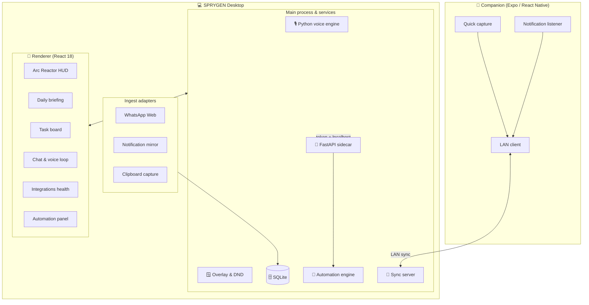

<div align="center">

# SPRYGEN

### Your voice, your machine, your automation layer.

A local-first desktop assistant that hears you, understands you, and does the work —<br />
running entirely on your own hardware.

<br />

[](https://github.com/MoulendraBalaji/SpryGen/actions/workflows/ci.yml)
[](./LICENSE)
[](#-installation)

[](https://www.electronjs.org/)
[](https://react.dev/)
[](https://www.typescriptlang.org/)
[](https://www.python.org/)
[](https://fastapi.tiangolo.com/)
[](https://sqlite.org/)
[](https://expo.dev/)
[](#-testing--quality)

<br />

**[Why SPRYGEN](#-why-sprygen)** · **[Features](#-feature-tour)** · **[Installation](#-installation)** · **[Configuration](#-configuration)** · **[Testing](#-testing--quality)** · **[Privacy](#-privacy--security)**

</div>

---

## ✨ Why SPRYGEN

Most assistants send your voice, your screen and your notes to somebody else's server.
SPRYGEN was built the other way around.

<table>
<tr>
<td width="50%" valign="top">

**🔒 Private by architecture**

Wake word, speech recognition, speaker identity and text-to-speech all run on your
machine. Personal prompts are routed to a local model and never leave the device —
only non-personal prompts may use an optional cloud provider you configured.

</td>
<td width="50%" valign="top">

**⌨️ No account, no API key required**

Out of the box SPRYGEN works fully offline against [Ollama](https://ollama.com/).
Cloud providers are strictly opt-in fallbacks. There is nothing to sign up for and
nothing that breaks when a free tier disappears.

</td>
</tr>
<tr>
<td width="50%" valign="top">

**🤖 It actually does things**

Real browser and desktop automation — navigate, click, type, scrape, take
screenshots — behind a single-flight engine with a live kill switch and a
confirmation prompt for anything that changes your system.

</td>
<td width="50%" valign="top">

**🧪 Verified, not claimed**

Every capability is backed by an automated check: typed IPC, Python security tests,
Vitest component tests and a Playwright test that boots the real app, chats, creates
a task and restarts to prove persistence.

</td>
</tr>
</table>

---

## 🚀 Feature Tour

### 🎙️ Speech-to-speech, entirely on-device

Ask by voice, hear the answer back — no cloud round-trip at any step.

| Stage | Engine | Runs on |
| :--- | :--- | :--- |
| Wake word | `openWakeWord` | Your machine |
| Speech → text | `faster-whisper` | Your machine |
| Speaker identity | `Resemblyzer` | Your machine |
| Text → speech | `Kokoro`, with OS voice fallback | Your machine |

Say the wake phrase, speak your command, and SPRYGEN routes the transcript through
the exact same pipeline as typed input — tasks get created, memories get stored,
automation gets queued — then reads the answer back aloud. Prefer it quiet?
Turn off **Speak replies aloud** in Settings.

> **About the voice lock.** The speaker gate compares a live recording against your
> enrolled voiceprint. It is a convenience feature, **not** an authentication
> boundary: a replay recording or a cloned voice can fool it. When the local models
> are missing it fails *closed* — nothing is ever verified.

### 🪟 An overlay that knows when to disappear

- **Summon instantly** with `CmdOrCtrl + Shift + Space` (or `Alt + J`).
- **Distraction shield**: detects fullscreen games and videos, honours quiet hours,
  and buffers what it would have shown you into a local backlog.
- **Tray resident**: toggle listening, open settings, or fire a quick capture
  without leaving the keyboard.

### 🔌 Feeds from everywhere you already work

| Adapter | What it does |
| :--- | :--- |
| **WhatsApp Web** | Parses group announcements into dated tasks. |
| **Mobile mirror** | Streams phone notifications over your LAN. |
| **Clipboard capture** | `CmdOrCtrl + Shift + J` turns selected text into a task with a parsed due date. |
| **Health monitor** | Live status for every provider, adapter and service, with one-click re-authorisation. |

### 🤖 Automation with a seatbelt

- **Browser tasks**: multi-step navigate / click / type / extract / screenshot.
- **Web scraping as a tool**: ask the assistant to *"summarise this page"* and it
  fetches, cleans and reasons over the content.
- **Desktop actions**: screenshots, typing, hotkeys and bounded mouse control.
- **Guard rails**: SSRF blocking, single-flight execution, a global kill switch and
  an explicit confirmation dialog before any side-effecting action.

### 🧠 Routing that respects your privacy

```
explicit command ─▶ anchored fast-path rules        (instant, deterministic)
otherwise        ─▶ LLM tool-calling (tools-capable provider)
otherwise        ─▶ plain chat (any available provider)

         ┌──────────────────────────────────────────────┐
chain ─▶ │ Groq → Cerebras → OpenRouter → Mistral → Ollama │
         └──────────────────────────────────────────────┘
              keyless providers are skipped automatically
              personal data ⇒ local provider, always
```

### 📱 Companion app

A React Native (Expo) app pairs over your local network with a 6-digit PIN that
exchanges per-device tokens — quick capture from your phone, notification relay back
to the desktop, no cloud relay in between.

### 🎨 An interface you'll actually enjoy

A frameless **Opera GX** shell, tactical monospace typography, a keyboard-first
command palette (`Ctrl + K`), and an **Arc Reactor HUD** that tells you at a glance
whether the engine is `idle`, `listening`, `processing`, `automating` or in `error`.

---

## ✅ Implemented vs. planned

Everything below is implemented and covered by the acceptance suite. Anything not
listed is **not** claimed.

| Area | Status |
| :--- | :--- |
| Electron + React shell, Arc Reactor HUD, command palette, overlay & DND | ✅ Implemented |
| SQLite (`better-sqlite3`) as the single datastore; in-memory emergency fallback | ✅ Implemented |
| Stateless Python FastAPI sidecar — `/api/chat` → `{ answer, intent, actions }` | ✅ Implemented |
| Keyless provider chain with cooldowns, `Retry-After` handling and a privacy gate | ✅ Implemented |
| Anchored fast-path + LLM tool-calling; side-effecting actions require confirmation | ✅ Implemented |
| Per-launch token, random port, Host/Origin checks, SSRF guards, single-flight automation, ESC kill switch | ✅ Implemented |
| LAN sync: `/status` (no secrets), `/pair` per-device tokens, `/capture`, 64 KB cap, PIN lockout | ✅ Implemented |
| Local voice pipeline (wake word → STT → speaker lock → TTS) with fail-closed behaviour | ✅ Implemented <br /><sub>core stack shipped in installers; speaker lock + Kokoro are optional extras</sub> |
| Speech-to-speech loop: voice command → chat → spoken answer | ✅ Implemented |
| Screen understanding via `desktopCapturer` + local Ollama vision | ✅ Implemented |
| Expo companion app (pairing, quick capture, notification relay) | ✅ Implemented |
| Cross-platform installers | ⚠️ Partially verified — CI builds on Windows and Linux; macOS packaging is configured but not exercised in CI |
| Multi-user accounts, cloud sync, mobile push | ❌ Not planned |

---

## 🏗️ Architecture



**Design rules that the codebase holds itself to**

- The Electron renderer never guesses: if the preload bridge is missing, the app
  shows a blocking error screen instead of fake data.
- The Python backend is stateless. It returns intent and proposed actions; the
  desktop applies each action exactly once.
- Everything security-relevant fails closed, and every fallback is explicit.

---

## 📦 Installation

**Prerequisites**

- Node.js **18+** (20+ recommended) and npm **9+**
- Python **3.11+**
- Git

```bash
# 1 — clone
git clone https://github.com/MoulendraBalaji/SpryGen.git
cd SpryGen

# 2 — desktop dependencies
npm install

# 3 — Python backend dependencies
pip install -r backend/requirements.txt

# 4 — optional: full offline voice extras (speaker lock + local Kokoro voice).
#    Packaged builds already include capture, wake word and speech-to-text
#    (pip install -r backend/requirements-voice-core.txt).
pip install -r backend/requirements-voice.txt

# 5 — optional: companion app
cd companion-app && npm install && cd ..
```

### Run it

```bash
npm run dev
```

That starts Vite, Electron and the Python sidecar together. Prefer a local model
first? Install [Ollama](https://ollama.com/) and pull one:

```bash
ollama pull llama3.2
```

### Build it

```bash
npm run typecheck       # TypeScript, no emit
npm run build           # production bundles
npm run package:win     # or package:mac / package:linux
```

Installers land in `release/`.

The frozen Python sidecar needs **PortAudio** so the packaged app can open the
microphone. The Windows and macOS `sounddevice` wheels bundle it; on Linux the
build host must provide it (the build fails with a clear message if it is
missing). It is then bundled into the app — end users install nothing:

```bash
sudo apt-get install -y libportaudio2
```

---

## ⚙️ Configuration

SPRYGEN works with an empty `.env`. Copy the example to get started:

```bash
cp .env.example .env
```

```env
# --- Optional cloud providers (all free-tier; leave blank to stay local) ---
GROQ_API_KEY=""
CEREBRAS_API_KEY=""
OPENROUTER_API_KEY=""
MISTRAL_API_KEY=""

# --- Local model endpoint (no key required) ---
SPRYGEN_OLLAMA_URL="http://127.0.0.1:11434"

# --- Offline voice pipeline (optional; see backend/requirements-voice.txt) ---
# SPRYGEN_WAKE_MODEL=""            # custom openWakeWord .onnx; blank = bundled models
# SPRYGEN_VOICE_MODELS_DIR=""      # where wake models are cached (default ~/.sprygen/voice-models)
# SPRYGEN_WHISPER_MODEL="base.en"  # faster-whisper model size
# SPRYGEN_TTS_VOICE="af_heart"     # Kokoro voice
# SPRYGEN_VISION_MODEL="llava"     # local vision model for screen understanding

# --- LAN sync ---
SPRYGEN_SYNC_PORT=8765
```

### Providers

You never *need* a key. With every key blank SPRYGEN runs entirely on Ollama. The
cloud providers below are optional fallbacks, all with free tiers at the time of
writing:

| Provider | Key | Notes |
| :--- | :--- | :--- |
| **Ollama** | none | Local, offline, no account. The default. |
| **Groq** | `GROQ_API_KEY` | Very fast inference; rate-limited free tier. |
| **Cerebras** | `CEREBRAS_API_KEY` | Free tier; rate-limited. |
| **OpenRouter** | `OPENROUTER_API_KEY` | Use the `:free` model variants. |
| **Mistral** | `MISTRAL_API_KEY` | Free experimentation tier. |

> Free tiers, model names and rate limits change often. Check each provider's
> pricing page before relying on them. Model configuration lives in
> `backend/providers.json` — updating a model name needs no code change.

### Global hotkeys

| Shortcut | Action | Scope |
| :--- | :--- | :--- |
| `CmdOrCtrl + Shift + Space` | Summon / hide the overlay | System-wide |
| `Alt + J` | Alternative overlay toggle | System-wide |
| `CmdOrCtrl + Shift + J` | Quick-capture selected text as a task | System-wide |
| `Esc` | Kill switch while automation runs | System-wide |

### Voice setup

**Packaged builds already include the core voice stack** — microphone capture,
wake word, speech-to-text, and text-to-speech via the OS synthesizer — so
speech-to-speech works out of the box. On first use the two models (openWakeWord
and Whisper `base.en`, ~150 MB total) are downloaded once, then cached locally
(openWakeWord under `~/.sprygen/voice-models`, Whisper in the Hugging Face
cache). No account, key or network call is needed after that.

From a source checkout, install the same stack with:

```bash
pip install -r backend/requirements-voice-core.txt
```

Two optional extras are **not** bundled because they pull in PyTorch (~2 GB):
the speaker lock (`Resemblyzer`) and fully local speech synthesis (`Kokoro`).
Install both with `pip install -r backend/requirements-voice.txt`. Without them,
replies are spoken with the built-in OS voice and voice enrollment is disabled —
the wake-word loop still runs.

1. Open **Settings → Voice & Audio** and press **Enroll Voiceprint** (5 short
   samples) — only available once the speaker lock is installed.
2. Flip **Automatic listening** on and say the wake phrase.
3. Use **Test Speech (TTS)** to confirm audio output; toggle **Speak replies
   aloud** to control whether answers are read back.

Settings shows a live per-component readout (capture · wake · stt · speaker · tts)
so you always know exactly what is installed and what is missing, plus the exact
list of wake phrases the engine is listening for.

#### Wake phrase

Out of the box the engine listens for the **stock openWakeWord phrases** —
`alexa`, `hey_jarvis`, `hey_mycroft`, `hey_rhasspy`, `timer` and `weather`. The
current list is always shown in **Settings → Voice & Audio**. To use your own
phrase, train or download an openWakeWord `.onnx` model and point
`SPRYGEN_WAKE_MODEL` at it:

```bash
# A single custom model replaces the bundled set.
SPRYGEN_WAKE_MODEL="C:\path\to\my_model.onnx"
```

The models live in a per-user cache so they survive reinstalls and are never
re-downloaded per launch; override the location with
`SPRYGEN_VOICE_MODELS_DIR`.

### Screen understanding

Screen capture grabs a frame locally with `desktopCapturer` and asks a **local
Ollama vision model** to describe it — the image never leaves your machine. It
requires Ollama to be running with a vision model installed:

```bash
ollama pull llava
```

If Ollama is not running or the model is missing, the panel reports exactly that
(plus the command to run) rather than failing silently.

---

## 🧪 Testing & Quality

One command runs the whole acceptance suite, in order, and prints `PASS`/`FAIL` for
every phase — stopping at the first failure:

```bash
bash scripts/acceptance.sh        # Linux / macOS / Git Bash

./scripts/acceptance.ps1          # Windows PowerShell
```

| Step | Command | Covers |
| :--- | :--- | :--- |
| 1 | `npm run typecheck` | Typed IPC surface, datastore rules |
| 2 | `npm run build` | Shared zod schemas, renderer + main bundles |
| 3 | `pytest backend/tests` | Routing, provider fallback, trust boundary, SSRF, sync-server security, voice/vision fail-closed |
| 4 | `npm run test` | Vitest — stores, speech-to-speech loop, health panel, bridge error screen |
| 5 | `npm run test:e2e` | Playwright boots the real Electron app against a mock model, chats, creates a task, restarts, verifies SQLite persistence |

CI runs the identical script on **ubuntu-latest** and **windows-latest** for every
push and pull request (`.github/workflows/ci.yml`), and release builds depend on it
passing.

---

## 📁 Repository layout

```
SpryGen/
├── electron/                   # Main process & preload
│   ├── ipc/                    #   typed IPC channel registration
│   ├── services/
│   │   ├── adapters/           #   WhatsApp / notification ingest
│   │   ├── voice/              #   thin client over the Python voice engine
│   │   ├── db.ts               #   SQLite (+ in-memory emergency fallback)
│   │   ├── deviceSync.ts       #   LAN pairing & capture server
│   │   ├── overlay.ts          #   window state machine & DND
│   │   └── pythonClient.ts     #   typed proxy to the sidecar
│   ├── main.ts
│   └── preload.ts
├── src/                        # React renderer
│   ├── components/             #   shell, HUD, panels
│   ├── design-system/          #   clay tokens, buttons, inputs, cards
│   ├── lib/                    #   typed bridge access + speech-to-speech loop
│   ├── store/                  #   zustand stores
│   ├── App.tsx
│   └── main.tsx
├── backend/                    # Python FastAPI sidecar (stateless)
│   ├── agents/                 #   chat / task / memory / briefing agents
│   ├── llm/                    #   intent router + provider chain
│   ├── services/automation/    #   Selenium + PyAutoGUI + BeautifulSoup
│   ├── services/voice/         #   offline voice pipeline (fail-closed)
│   ├── services/vision.py      #   screen → local vision
│   └── server.py               #   dynamic port + launch token
├── companion-app/              # Expo companion
├── shared/                     # shared types + zod IPC schemas
├── tests/                      # Vitest unit tests + Playwright e2e
├── scripts/                    # acceptance runners + security checks
├── electron-builder.yml
├── electron.vite.config.ts
└── package.json
```

---

## 🛡️ Privacy & Security

Security decisions, stated plainly:

- **Local storage.** Tasks, chat history, notes and biometric embeddings live in a
  local SQLite database. Nothing syncs to a server.
- **No raw audio retained.** Enrollment stores a numeric speaker vector, never the
  recording.
- **The speaker lock is not authentication.** It can be defeated by a replay or a
  cloned voice. It fails closed when models are missing, but it should never guard
  sensitive material on a shared machine.
- **Prompt privacy.** Prompts classified as personal — memories, credentials,
  schedules, screen and voice payloads — are forced onto a local provider. Cloud
  providers only ever see non-personal prompts, and only if you configured a key.
- **Local-only network surface.** The sidecar binds `127.0.0.1` on a random port with
  a per-launch bearer token, validates `Host` and `Origin`, and ships no CORS
  middleware. LAN sync issues per-device tokens via PIN handshake and never exposes
  the pairing code on `/status`.
- **Automation guard rails.** Scraping is behind an SSRF allowlist, workflows run
  single-flight with real aborts, and side-effecting actions ask first.

Licenses for every bundled model and library — including the full voice stack — are
listed in [`THIRD_PARTY.md`](./THIRD_PARTY.md).

---

## 🤝 Contributing

Issues and pull requests are welcome. Before opening a PR, please run:

```bash
bash scripts/acceptance.sh   # or ./scripts/acceptance.ps1 on Windows
```

and make sure every phase reports `PASS`.

---

## 📄 License

Released under the **MIT License** — see [`LICENSE`](./LICENSE).

<div align="center">
<br />

**SPRYGEN** — built by [Moulendra Balaji](https://github.com/MoulendraBalaji)

<sub>Your voice never leaves your machine.</sub>

</div>
